# ZFS Director

**English** · [Русский](README.ru.md)

Manage ZFS in Unraid, browse snapshots in a **Snapshot File Manager**, automate snapshot policies with **Sanoid**, and replicate datasets with the **Syncoid wizard**.

- **[Snapshot File Manager](#snapshot-file-manager):** browse folders in a restore point, select files, download a ZIP and review a file restore.
- **[Sanoid integration](#sanoid-snapshot-policies):** choose snapshot creation times, retention and protected removal of old snapshots; review External and Managed policies.
- **[Syncoid integration](#syncoid-replication):** create local or SSH replication jobs through Source → Destination → Schedule → Review, with progress and verified results in Jobs.

**[Download the Unraid installation ZIP](https://github.com/d1-m4ss/zfs-director/releases/download/2026.10.22.1/ZFS-Director-2026.10.22.1-Unraid-RC1.zip)** · [SHA256SUMS](https://github.com/d1-m4ss/zfs-director/releases/download/2026.10.22.1/SHA256SUMS) · [Installation and rollback](docs/INSTALLATION.md)

**RC1 2026.10.22.1** was tested on a physical Unraid 7.3.3 server with OpenZFS 2.4.4 and in an isolated VM. See the [verification results](docs/TESTING.md#rc1-verification-2026-10-22) for installation, upgrades, ZFS operations and GUI checks.

<table>
<tr><th>Snapshot File Manager</th><th>Sanoid snapshot policies</th><th>Syncoid Replication Wizard</th></tr>
<tr>
<td>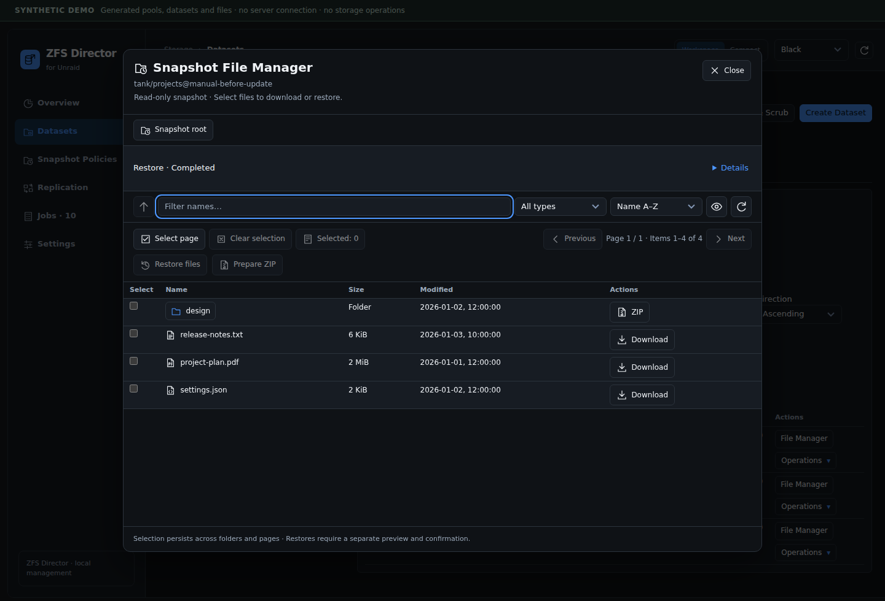</td>
<td>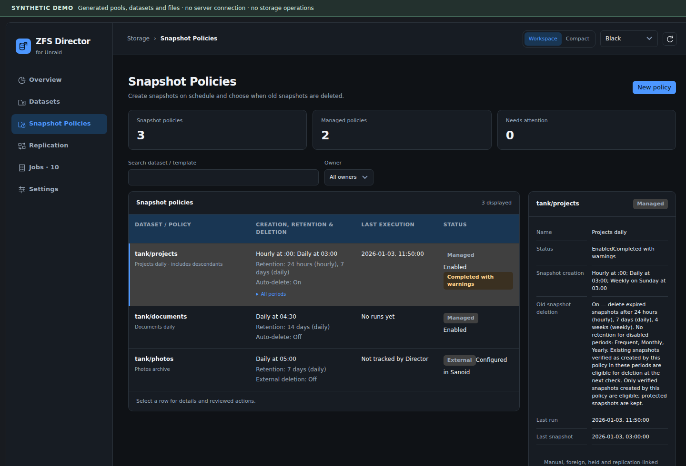</td>
<td>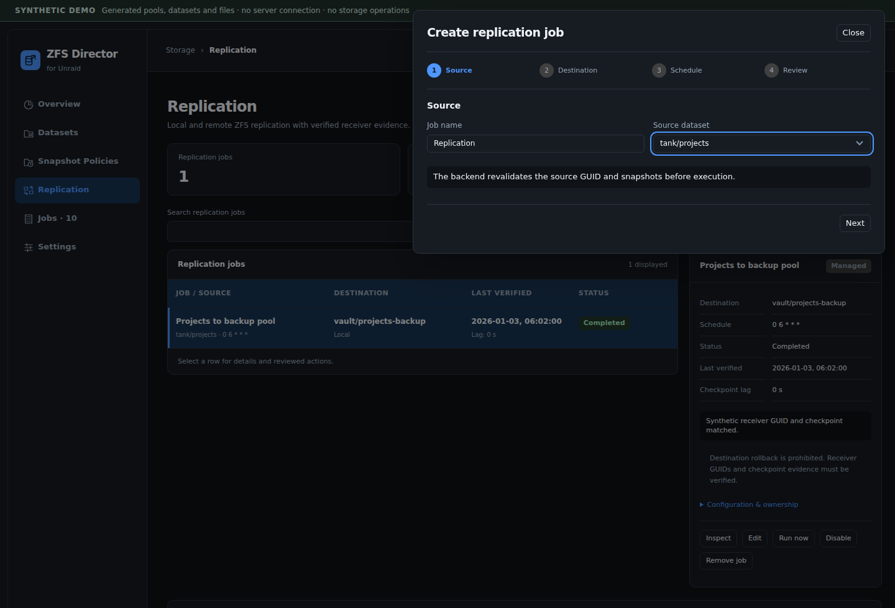</td>
</tr>
</table>

## Install in Unraid

1. Open **Plugins → Install Plugin**.
2. Paste the following URL and click **Install**:

   ```text
   https://github.com/d1-m4ss/zfs-director/releases/download/2026.10.22.1/zfs-director.plg
   ```

3. Open **Main → ZFS Director**.

The installer downloads and verifies the ready-made package, creates its own storage and starts the background services. **No terminal activation or manual folder creation is needed.** Fresh configuration leaves Sanoid / Syncoid integration OFF. Existing settings, Jobs and schedules are preserved.

The [ZIP and checksums](https://github.com/d1-m4ss/zfs-director/releases/tag/2026.10.22.1) are also available. For existing legacy registrations, use the matching compatibility PLG described in [installation, upgrades and rollback](docs/INSTALLATION.md).

## Snapshot File Manager

### Browse, download and restore files

Open **Datasets → choose a filesystem dataset → File Manager**, select a snapshot and click **Open File Manager**. You can also open files from the snapshot list.

The Snapshot File Manager browses a selected snapshot, not the current writable directory. It supports directory navigation, filtering, sorting, pagination and multiple selection. Files and folders can be prepared as a ZIP archive; preparation and the server-side transfer appear in Jobs.


For a restore, select the files, choose a destination and mode, then request a fresh review. The review shows the target, selection, size and conflicts before explicit confirmation. Overwrite recovery retains replaced content where the backend workflow provides it; inspect the result before discarding recovery material.

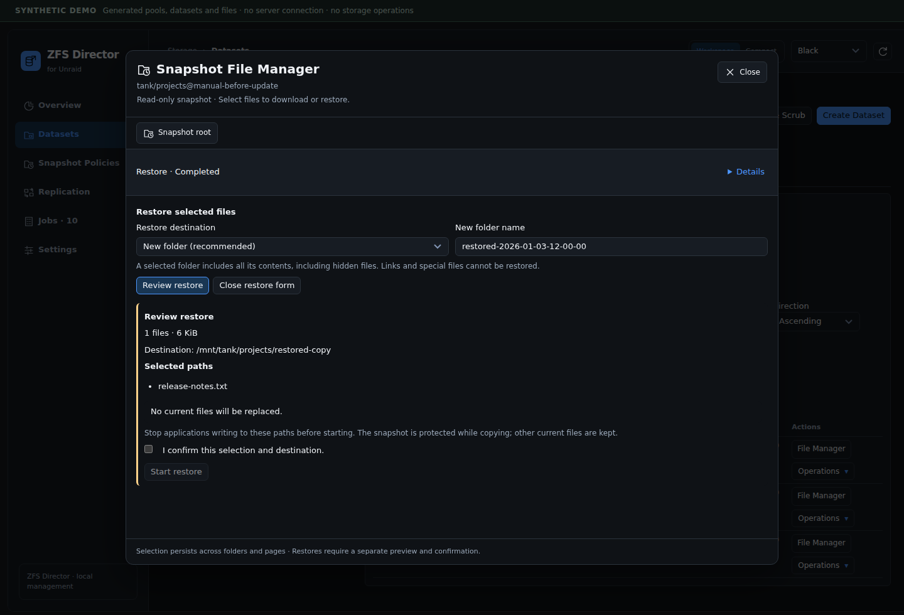


### Create and inspect restore points

1. Select a dataset and open **Snapshots**.
2. Use **Take Snapshot** to review the selected dataset and optional descendants.
3. Search or filter the list; enable the recursive view when inspecting descendants.
4. Open an individual snapshot's operations or its File Manager.

Holds, clones and filesystem references can prevent deletion. A snapshot is a local restore point; it does not replace an independent backup.

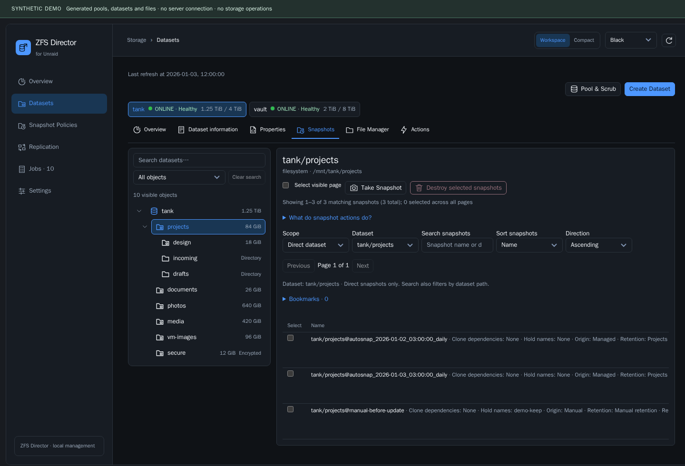


## Sanoid snapshot policies

Find detection and the permission switch under **Settings → Sanoid / Syncoid Integration**. The **Snapshot Policies** and **Replication** navigation entries appear when compatible tools are installed, integration is allowed, and configuration/scheduler checks pass.

Sanoid / Syncoid is optional. **Enabling the integration allows Director to inspect and manage reviewed definitions; it does not automatically create policies, adopt external scripts or start replication.** Each definition has its own state and review workflow.

A policy separates:

- **When snapshots are created:** the time or minute within each enabled period.
- **How long they are retained:** the retention window for each period.
- **Whether old eligible snapshots may be removed:** a visible policy setting, subject to backend protection checks.

For example: hourly at `:00`, retain 24 hours; daily at `03:00`, retain 7 days. Times use the server's configured timezone. Short scheduler checks and the actual snapshot creation time are separate concepts; ordinary users do not need to write cron expressions. Advanced retains templates, exclusions and specialized settings.

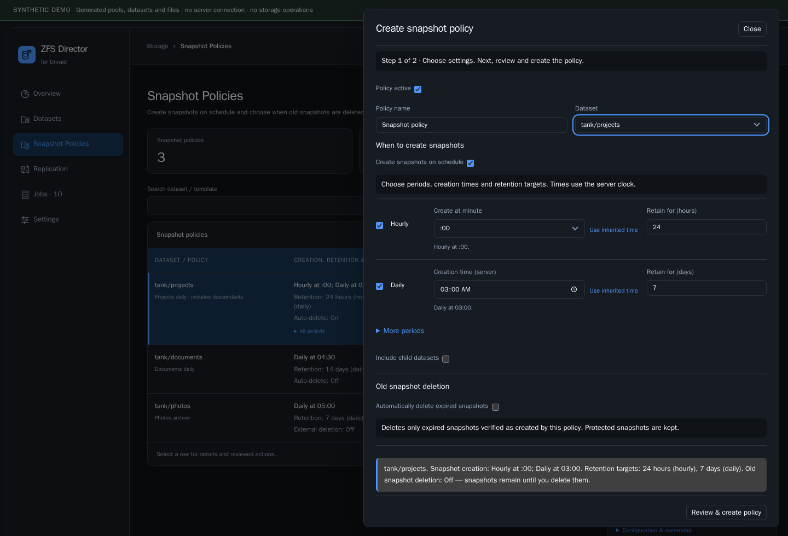

### External and Managed remain separate

| Ownership | Meaning |
| --- | --- |
| External | Existing Sanoid configuration or scripts remain owned externally; Director displays them for inspection |
| Managed | Director stores and schedules a reviewed definition in its own persistent state |

A reviewed ownership transfer creates a disabled Managed definition only after the previous launcher is verified inactive. Director does not silently rewrite User Scripts or external schedules. A manual snapshot whose name resembles a Sanoid snapshot does not acquire Managed ownership from its name.

Managed creation uses Sanoid snapshot-taking separately from Director retention. Native pruning must not bypass Director's GUID ownership and protection checks. Foreign/manual snapshots, holds, clones and replication references are preserved when they cannot be safely approved for removal.


## Syncoid replication

The wizard separates **Source → Destination → Schedule → Review**. It supports local pool destinations and SSH destinations when credentials, permissions and native prerequisites are valid.

Reviewing or saving a definition is not a transfer. Run and enable decisions are explicit. Syncoid exit status alone is not treated as verified replication success: receiver identity and checkpoint evidence are part of the result. Interrupted/resumable work remains visible for inspection. Automatic destination rollback is not part of this workflow.


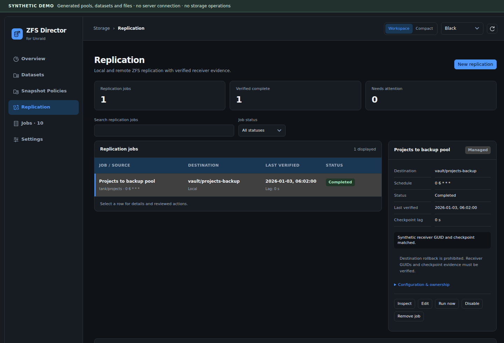


## What it does

| Area | Capabilities |
| --- | --- |
| Overview | Imported pools, health indicators, capacity and background-task activity |
| Datasets | Workspace tree and Compact view, search/filtering, properties and space accounting |
| Dataset actions | Create, rename, edit properties, quotas, POSIX ACLs, encryption lock/unlock, clone and reviewed promotion where supported |
| Snapshots | Create, search, filter, recursive views, rename, hold/release, clone, reviewed deletion and dataset rollback |
| Snapshot File Manager | Browse snapshot files, prepare ZIP archives and review file restores |
| Directory operations | Directory listings, move/rename, conversion to a dataset, guarded deletion and recovery inspection |
| Snapshot Policies | Sanoid policy review, explicit creation times, retention settings and External / Managed ownership |
| Replication | Syncoid wizard for local and SSH destinations, scheduling and verified-result reporting |
| Jobs | Requested operations, progress, errors, stage history, recovery controls, filtering and pagination |
| Pool & Scrub | Native diagnostics, scrub progress, reviewed scrub requests and read-only inspection of native scheduling |

### Why Sanoid and Syncoid

We compared **Sanoid/Syncoid 2.2.0 and ZnapZend 0.23.6** in an isolated VM with real ZFS 2.2.2. The study covered snapshots, retention, replication, fault injection and recovery after VM restarts.

| Check | Sanoid / Syncoid | ZnapZend |
| --- | --- | --- |
| Real ZFS scenarios | 12/12 passed | 12/12 passed after adapter workarounds |
| Fault injection and data safety | 12/12 passed | 10/12 passed |
| Foreign objects, interrupted increments and retention | 4/5 passed | 3/4 passed |
| Normal VM reboot | 6/6 passed | 5/5 passed |
| VM hard reset during a transfer | 4/4 passed | 3/4 passed |
| Interrupted initial transfer with receiver protection | Resumed through a resume token; data matched | Required manual recovery of the incomplete receiver |
| Dedicated backend daemon | Not required | Required, approximately 32 MB RSS |

**We selected Sanoid + Syncoid** for resumable transfers, clearer failure reporting and operation without a dedicated daemon. Both tools could return zero while a foreign receiver snapshot blocked progress, so Director verifies the receiver's actual state. See the [comparison results and measurements](docs/TESTING.md#backend-comparison) for the findings behind this choice.

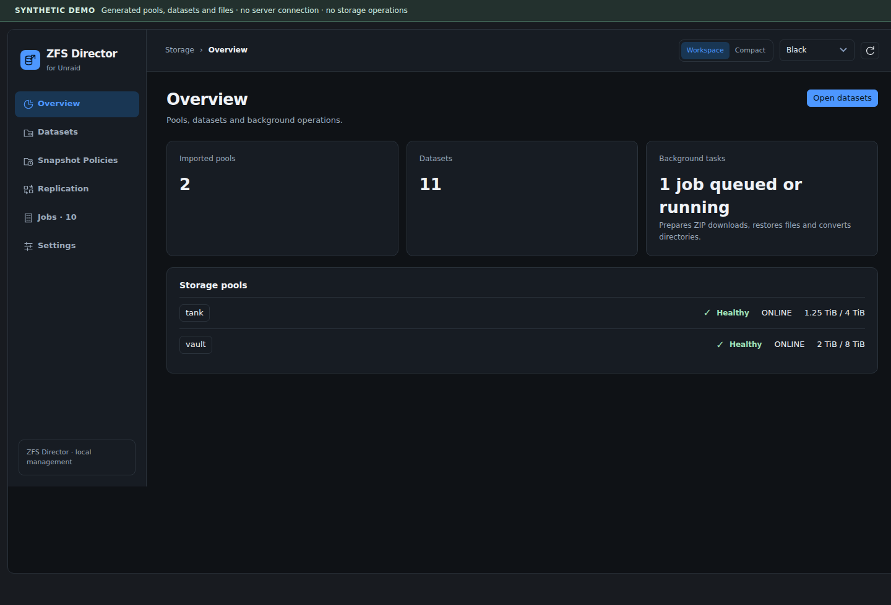


## A quieter workspace

Choose **Workspace** for a dataset tree beside the selected object's details, or **Compact** for a denser view. The selected dataset tab is retained when navigating between compatible objects, making it easier to inspect snapshots or actions across several datasets.

Themes include **Black, Gray, White and Azure**, plus **Unraid (auto)** to inherit the host theme. The interface adapts to narrow screens. Dialogs keep long reviews inside a bounded window rather than extending the entire page.

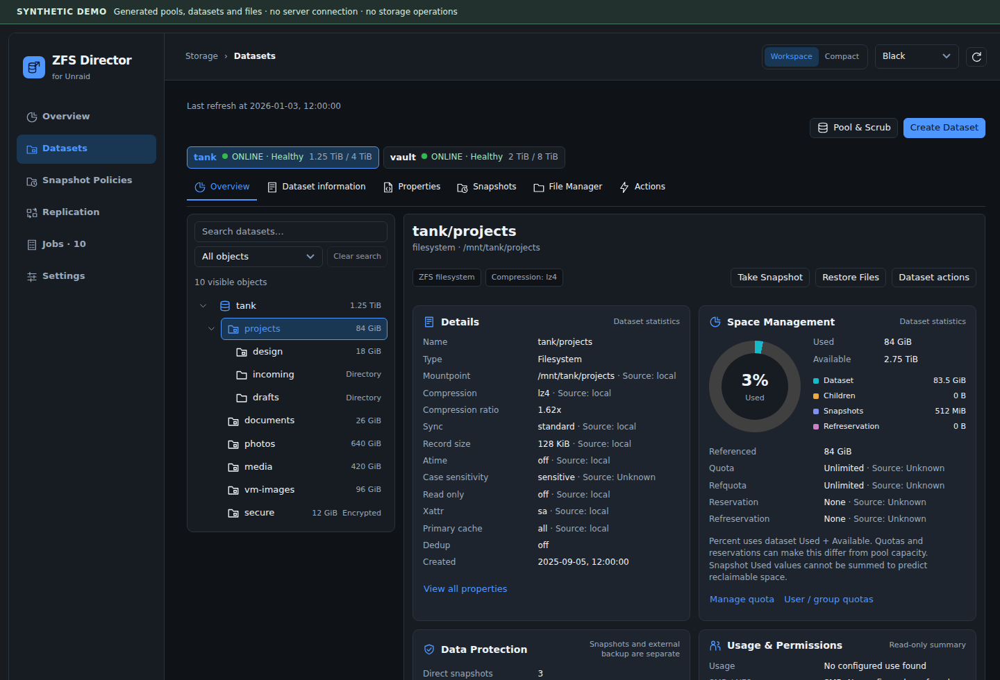

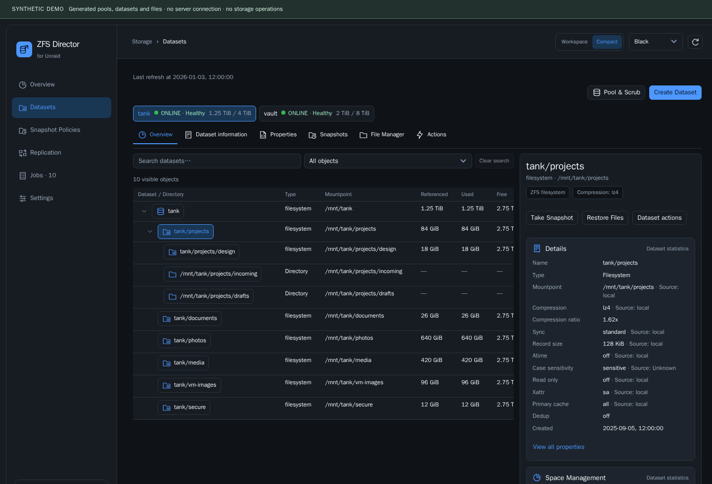

<details>
<summary>Other themes and a narrow screen</summary>

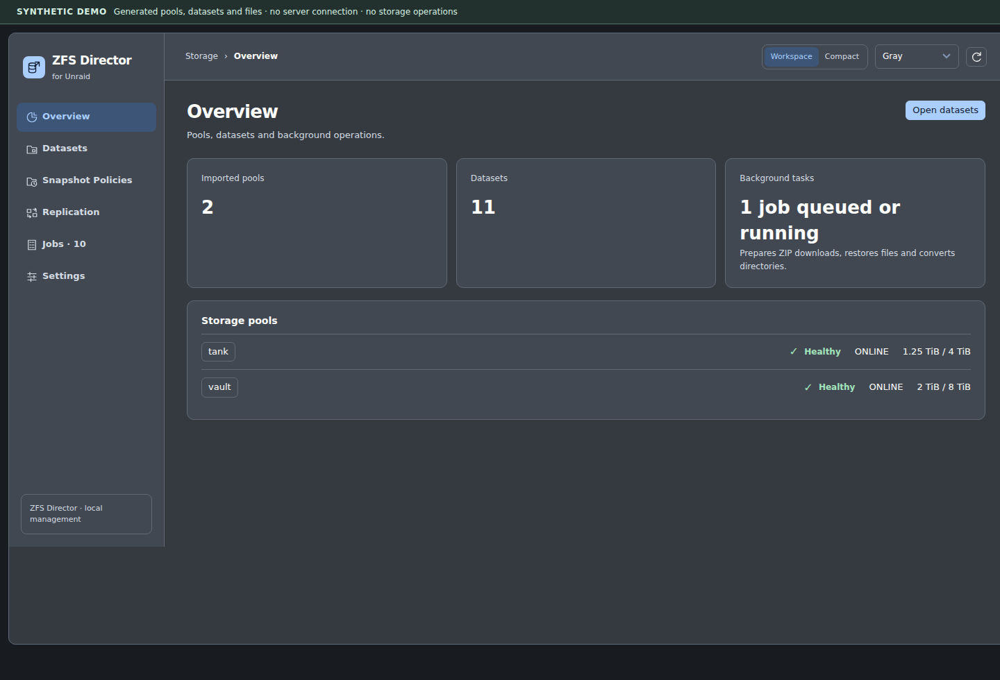

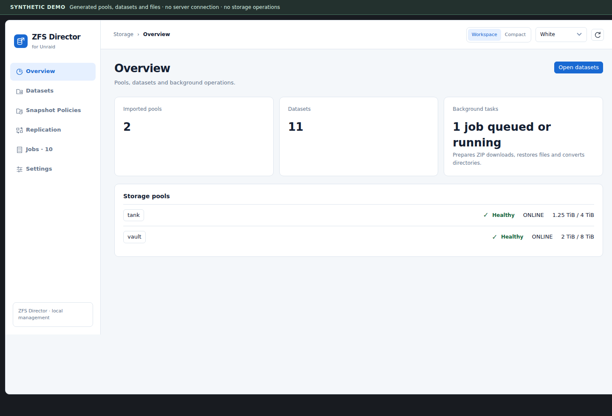

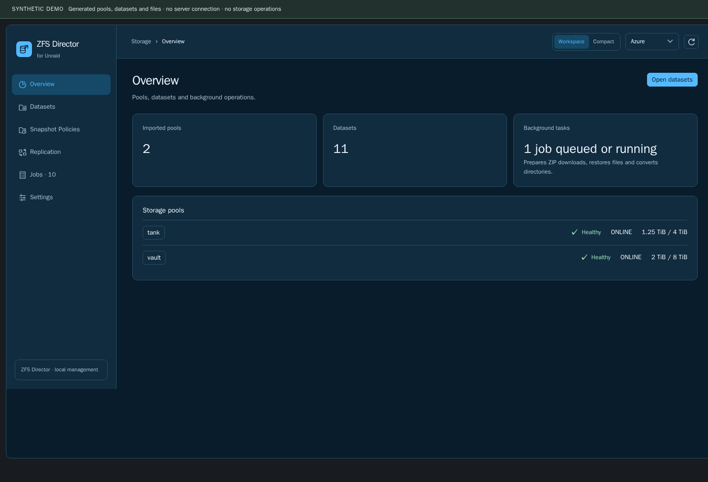

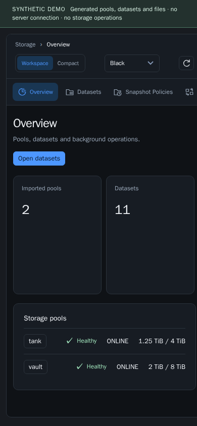

</details>


## Dataset and directory actions

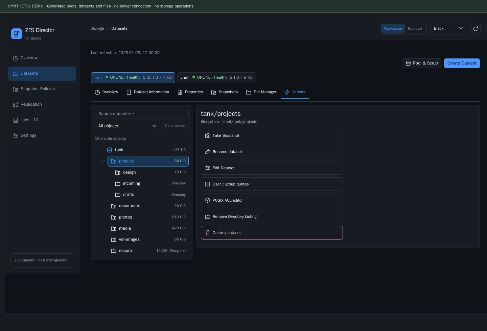

Actions open a modal editor followed by a separate review step. The header and footer stay available while long content scrolls inside. **Back** returns to the editor; **Close** dismisses the window and returns focus. Closing a window does not undo a request already accepted by the backend.

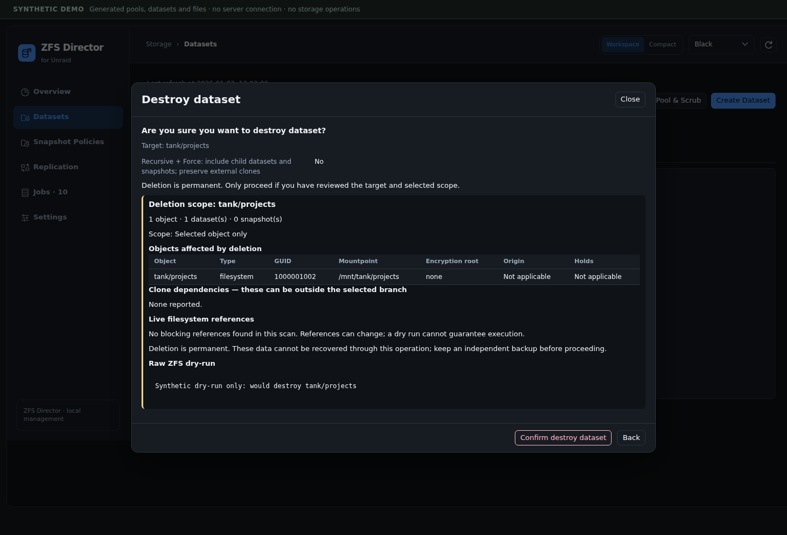

Destructive operations require the appropriate mode, fresh inventory, target identity and the operation-specific acknowledgment. Dataset/snapshot deletion uses a fresh server preview of the exact scope, including GUIDs and dependencies. Pool-root destruction is refused. Force does not mean stopping applications, releasing holds or destroying unrelated clones.

A verified read-only Docker mount of a parent does not block deletion of every ordinary child directory. Writable or unknown access, references to the selected directory or its contents, and nested mounts remain protected. The worker rechecks dependencies before execution.

### Convert a directory without discarding its original

Conversion is a background Job. Stop every writer first, allow room for the copies, and inspect the verified result before restarting writers. The operation copies through a confined workflow and retains the original for recovery.

New retained originals use a recognizable name such as `incoming_archived_<date-time>`. Older recovery names are preserved. Internal `.zfsm-mutation-*` working directories are normally hidden from the dataset tree and can be inspected through Jobs / recovery files. They must not be treated as ordinary disposable folders: unfinished work and retained data remain protected. Cleanup of eligible completed temporary data requires a fresh reviewed operation.


## Jobs: activity, progress and recovery

Jobs collects operations requested through Director: snapshot creation, file restore, ZIP preparation/download, conversion, deletion, configuration changes and Data Protection runs. External scripts keep their own ownership and execution history.

- Progress is numeric when a meaningful measure is available; otherwise the current stage is shown without inventing a percentage.
- Errors show the affected operation and available safe context.
- Stage history helps distinguish copying, verification, publication and recovery.
- Eligible retention deletion with protected snapshots left intact is reported as **Completed with warnings**, with an explanatory result.
- Filters separate operation types and attention states. Pagination defaults to **10 records**, with larger page sizes available.
- Recovery controls appear only where the backend supports them; completed or unsafe work is not silently resumed.

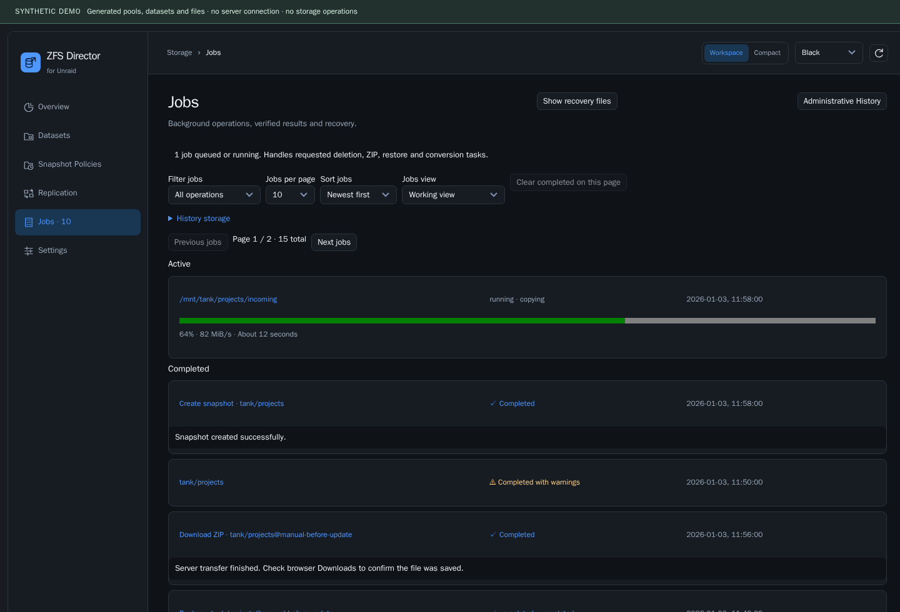

### Keeping history bounded

The worker checks history maintenance hourly. Default policy: 30 days, soft limits of 1,000 entries / 32 MiB, at least the newest 100 records retained, and bounded cleanup batches. Active, failed/recovery-related, referenced and retained-data records receive protection. These limits do not authorize deleting user data or recovery originals; protected history may keep storage above the soft limits and require inspection.


## Requirements and state

The target environment is **Unraid 7.3.3 with OpenZFS 2.4.4**. Native helper prerequisites are checked at runtime. Optional Data Protection requires a compatible trusted Sanoid / Syncoid installation.

Director creates and manages its persistent and temporary storage automatically. Upgrades preserve existing settings and journals. Do not replace current state with an old code backup during rollback.

A trusted path/ownership failure is a reason to inspect the installation, not to apply a recursive chmod. Existing external schedules are never permission-repaired or adopted automatically.

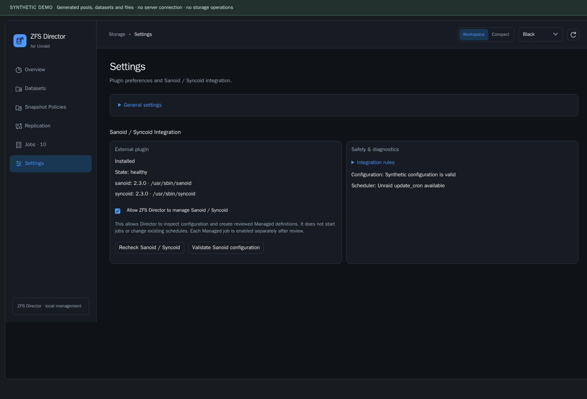


## Repository

```text
src/                 Plugin runtime, frontend and native helpers
tests/               Regression, GUI and integration tests
tools/               Package builder and release checks
docs/                Installation, development and testing guides
docs/images/         Screenshots using fictional data
docs/preview/        Synthetic demonstration and screenshot tools
```

## License and acknowledgments

[GPL-2.0-or-later](LICENSE).

Based on [ZFS Master](https://github.com/IkerSaint/ZFS-Master-Unraid) by [Carlos Rodriguez (IkerSaint)](https://github.com/IkerSaint), copyright 2021. Upstream attribution and retained notices are documented in [NOTICE.md](NOTICE.md).


## For developers

Source builds, tests and the synthetic preview are documented in the [developer guide](docs/DEVELOPMENT.md). They are not installation requirements.
