# ZFS Director

[English](README.md) · **Русский**

Управление ZFS в Unraid, **файловый менеджер snapshots**, автоматические политики **Sanoid** и **мастер репликации Syncoid** в одном интерфейсе.

- **[Snapshot File Manager](#snapshot-file-manager):** откройте snapshot как папку, найдите и выберите файлы, скачайте ZIP или восстановите выбранное после проверки.
- **[Интеграция Sanoid](#политики-sanoid):** задайте время создания snapshots, хранение и безопасное удаление старых копий; просматривайте External и Managed policies.
- **[Интеграция Syncoid](#репликация-syncoid):** настройте локальную или SSH-репликацию через Source → Destination → Schedule → Review; progress и проверенный результат доступны в Jobs.

**[Скачать установочный ZIP для Unraid](https://github.com/d1-m4ss/zfs-director/releases/download/2026.11.14.4/ZFS-Director-2026.11.14.4-Unraid.zip)** · [SHA256SUMS](https://github.com/d1-m4ss/zfs-director/releases/download/2026.11.14.4/SHA256SUMS) · [Установка и rollback](docs/INSTALLATION.md)

Каждый релиз проходит автоматические тесты (`npm run test:all`: unit- и PHP-тесты, GUI-проверки в Chromium и интеграционные). Установка, обновления, ZFS-операции и GUI проверены на физическом сервере Unraid 7.3.3 с OpenZFS 2.4.4 для RC1 (2026-10-22). Что покрыто, а что нет, описано в [результатах проверки](docs/TESTING.md).

<table>
<tr><th>Snapshot File Manager</th><th>Sanoid snapshot policies</th><th>Syncoid Replication Wizard</th></tr>
<tr>
<td>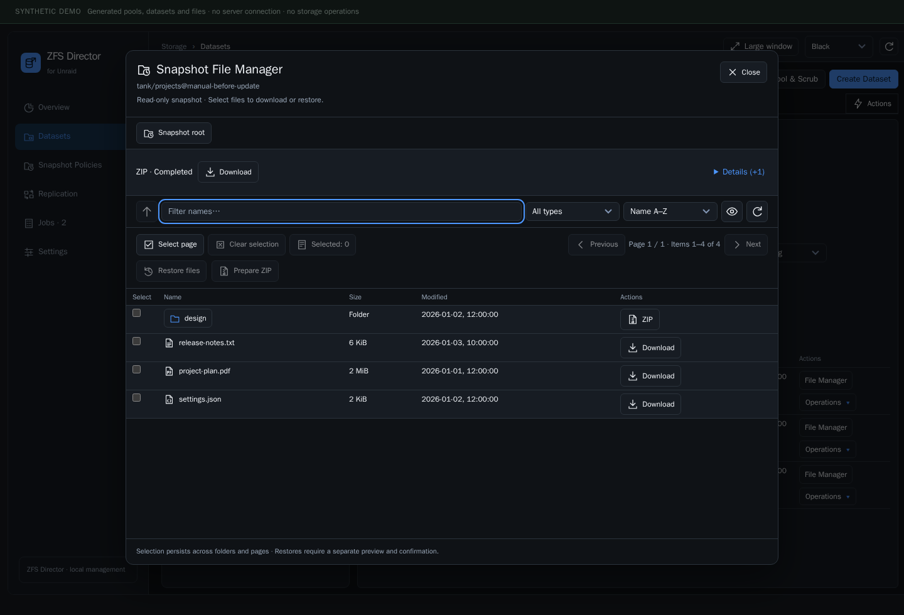</td>
<td>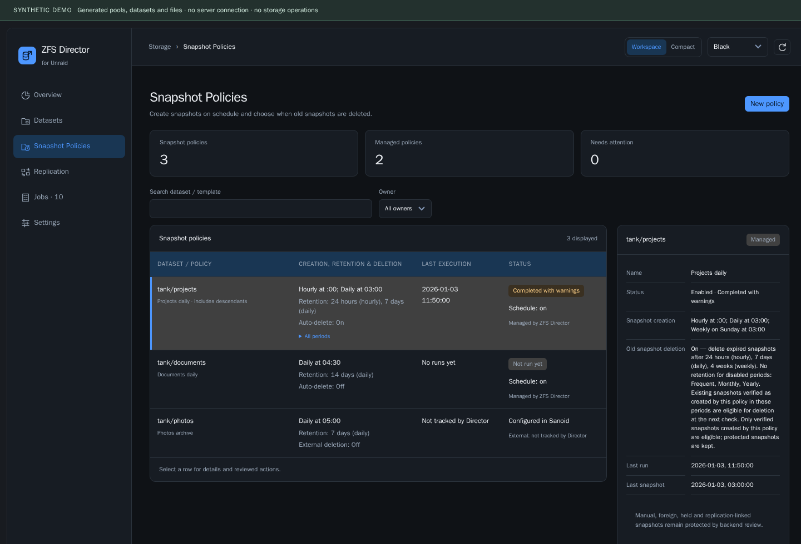</td>
<td>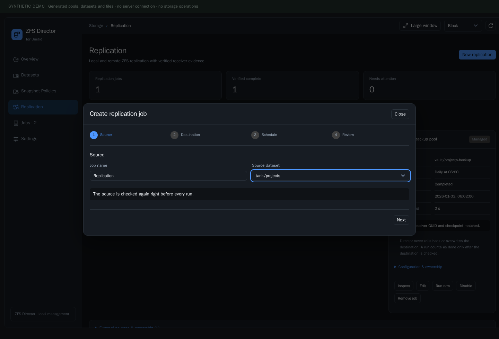</td>
</tr>
</table>

## Установка в Unraid

### Через Community Applications (рекомендуется)

1. Откройте вкладку **Apps** и найдите **ZFS Director**.
2. Нажмите **Install**.
3. Откройте **Main → ZFS Director**.

### По URL плагина

Откройте **Plugins → Install Plugin**, вставьте URL и нажмите **Install**:

```text
https://raw.githubusercontent.com/d1-m4ss/zfs-director/main/plugin/zfs-director.plg
```

Установщик сам скачает и проверит готовый пакет, создаст своё хранилище и запустит фоновые службы. **Терминал, отдельная активация и ручное создание папок не нужны.** В новой конфигурации интеграция Sanoid / Syncoid выключена. Существующие настройки, Jobs и расписания сохраняются.

> **Заменяет ZFS Master.** ZFS Director — преемник ZFS Master и не работает рядом с ним. Установщик убирает код ZFS Master и прежние регистрации плагина, сохраняя резервную копию для отката; настройки Director, Jobs, recovery и расписания сохраняются.

### Обновления

Новые версии появляются в **Plugins → Check for Updates** и в Community Applications. Ставили плагин по старому URL релиза (`…/releases/download/…/zfs-director.plg`)? Один раз переустановите его по URL выше с **Force Install**, чтобы проверка обновлений видела новые релизы.

Также доступны [ZIP и контрольные суммы](https://github.com/d1-m4ss/zfs-director/releases/tag/2026.11.14.4). Подробнее — в [инструкции установки, обновления и rollback](docs/INSTALLATION.md).

## Snapshot File Manager

### Найти, скачать и восстановить файлы

Откройте **Datasets → выберите filesystem dataset → File Manager**, выберите snapshot и нажмите **Open File Manager**. Также файлы можно открыть из списка snapshots.

Snapshot File Manager открывает содержимое выбранного snapshot. Есть переходы по каталогам, поиск, сортировка, страницы и множественный выбор. Для файлов и папок можно подготовить ZIP; подготовка ZIP отображается в Jobs, сама загрузка файла в Jobs не показывается.


Для restore выберите файлы, назначение и режим, затем запросите свежий review. До подтверждения видны target, selection, объём и conflicts. При поддерживаемом overwrite workflow заменённые данные сохраняются для recovery; перед очисткой проверьте результат.

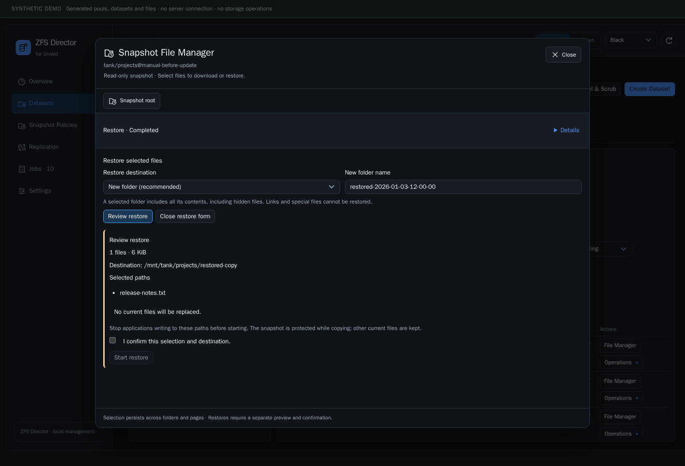


### Создать и просмотреть точку восстановления

1. Выберите dataset и откройте **Snapshots**.
2. Нажмите **Take Snapshot**, проверьте цель и при необходимости включите потомков.
3. Используйте поиск и фильтры; recursive view добавляет snapshots дочерних datasets.
4. Откройте операции нужного snapshot или его File Manager.

Holds, clones и реальные filesystem references могут блокировать удаление. Локальный snapshot — точка восстановления, а не замена независимой резервной копии.

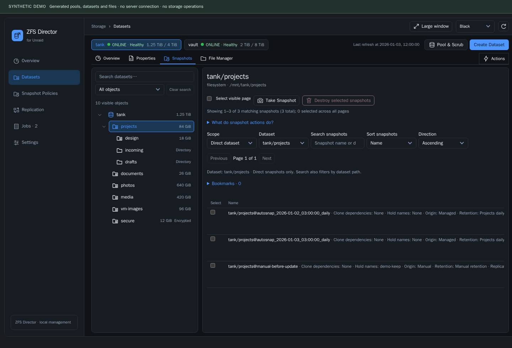


## Политики Sanoid

Обнаружение и разрешение управления находятся в **Settings → Sanoid / Syncoid Integration**. Пункты **Snapshot Policies** и **Replication** появляются, когда установлены совместимые инструменты, интеграция разрешена и проверки конфигурации/планировщика прошли.

Sanoid / Syncoid — необязательная интеграция. **Её включение разрешает Director проверять конфигурацию и управлять рассмотренными definitions. Оно само по себе не создаёт policies, не принимает чужие scripts и не запускает replication.** Каждая definition имеет собственное состояние.

В политике разделены:

- **Время создания snapshots:** час/минута внутри включённого периода.
- **Срок хранения:** retention window для каждого периода.
- **Удаление старых допустимых snapshots:** основная настройка с backend-защитой.

Пример: каждый час в `:00`, хранить 24 часа; ежедневно в `03:00`, хранить 7 дней. Используется timezone сервера. Частота служебной проверки расписания и время создания snapshot — разные понятия; обычная настройка не требует ввода cron. Templates, exclusions и специальные параметры доступны в Advanced.

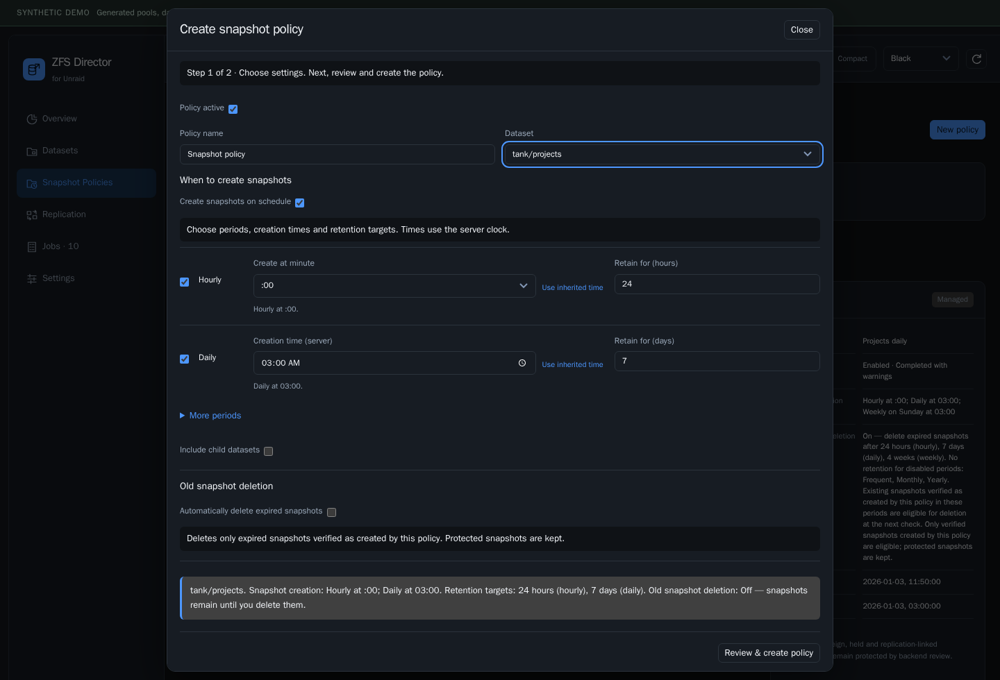

### Разделение External и Managed

| Владелец | Значение |
| --- | --- |
| External | Существующая конфигурация Sanoid или scripts остаются под внешним управлением; Director показывает их для inspection |
| Managed | Проверенная definition и её расписание хранятся в собственном persistent state Director |

Review передачи ownership создаёт выключенную Managed definition только после проверки, что предыдущий launcher неактивен. Director не переписывает User Scripts или внешние расписания автоматически. Manual snapshot не становится Managed из-за похожего на Sanoid имени.

Создание через Sanoid и retention внутри Director разделены. Native pruning не должен обходить GUID ownership и защитные проверки Director. Чужие/manual snapshots, holds, clones и replication references сохраняются, если backend не может безопасно разрешить удаление.


## Репликация Syncoid

Wizard разделён на **Source → Destination → Schedule → Review**. Шаг Destination начинается с выбора, куда идёт копия: **On this server** (локальный pool) или **On another server (SSH)** — при корректных credentials, правах и native prerequisites. Расписание начинается с раза в час; пресета «каждую минуту» для репликации нет.

Для SSH-получателя нужен SSH-ключ. Зарегистрируйте его в **Settings → Sanoid / Syncoid Integration → SSH keys for remote replication**: укажите путь к приватному ключу и к `known_hosts`; Director хранит только эти пути. Оба файла должны принадлежать root, ключ не должен быть доступен другим. Храните их на флешке в `/boot`: `/root` в Unraid находится в RAM и очищается при перезагрузке (общие папки в `/mnt/user` обычно доступны на запись другим и не принимаются). Карточка показывает готовые команды `ssh-keygen` и `ssh-keyscan`.

Просмотр или сохранение definition не запускает передачу. Enable и Run требуют явного действия. Успешный exit code Syncoid не считается достаточным доказательством: результат учитывает identity получателя и checkpoint evidence. Прерванная/resumable операция остаётся видимой для inspection. Автоматический rollback получателя в этот workflow не входит.


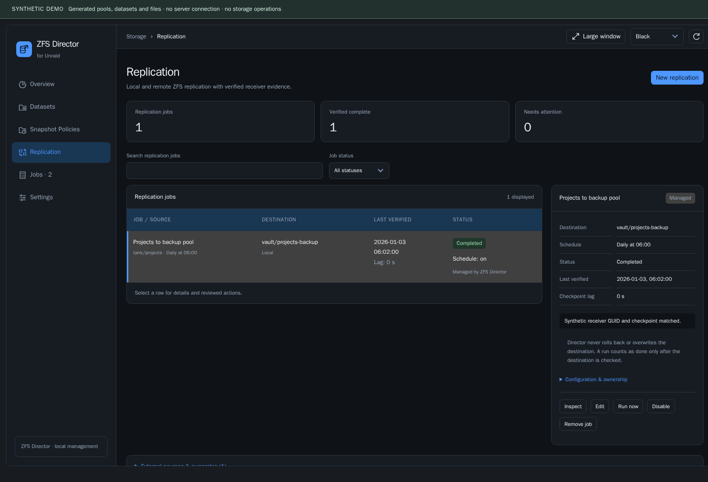


## Возможности

| Раздел | Что доступно |
| --- | --- |
| Overview | Импортированные pools, индикаторы здоровья, объём и состояние фоновых задач |
| Datasets | Дерево датасетов, поиск, фильтры, свойства и использование места |
| Действия с datasets | Создание, переименование, свойства, квоты, POSIX ACL, lock/unlock шифрования, clones и проверяемый Promote в поддерживаемых условиях |
| Snapshots | Создание, поиск, фильтры, просмотр потомков, rename, hold/release, clone, удаление и rollback с проверкой области |
| Snapshot File Manager | Просмотр файлов snapshot, подготовка ZIP и восстановление с предварительным review |
| Каталоги | Просмотр, move/rename, конвертация в dataset, защищённое удаление и inspection recovery |
| Snapshot Policies | Sanoid, время создания, retention и разделение External / Managed |
| Replication | Syncoid Wizard для локального pool или SSH-получателя, расписание и проверенный результат |
| Jobs | Операции, progress, ошибки, история этапов, recovery-контролы, фильтры, страницы и удаление завершённых записей |
| Pool & Scrub | Native diagnostics, progress scrub, подтверждённый запуск и чтение существующего расписания |

### Почему Sanoid и Syncoid

Мы сравнили **Sanoid/Syncoid 2.2.0 и ZnapZend 0.23.6** в изолированной VM с настоящим ZFS 2.2.2. Исследование включало snapshots, хранение, репликацию, искусственные отказы и восстановление после перезагрузок VM.

| Проверка | Sanoid / Syncoid | ZnapZend |
| --- | --- | --- |
| Сценарии на настоящем ZFS | 12/12 пройдено | 12/12 после обходов в адаптере |
| Искусственные отказы и безопасность данных | 12/12 пройдено | 10/12 пройдено |
| Чужие объекты, прерванные инкременты и хранение | 4/5 пройдено | 3/4 пройдено |
| Обычная перезагрузка VM | 6/6 пройдено | 5/5 пройдено |
| Жёсткий сброс VM во время передачи | 4/4 пройдено | 3/4 пройдено |
| Прерванная первая передача с защитой получателя | Продолжена через resume token; данные совпали | Потребовалось ручное восстановление незавершённого получателя |
| Отдельный daemon бэкенда | Не нужен | Нужен, около 32 MB RSS |

**Мы выбрали Sanoid + Syncoid** за возобновление передач, более понятные отказы и работу без отдельного daemon. У обоих инструментов чужой snapshot на получателе мог блокировать передачу при коде выхода 0, поэтому Director проверяет фактическое состояние получателя. Подробности выбора — в [результатах сравнения и замерах](docs/TESTING.md#backend-comparison).

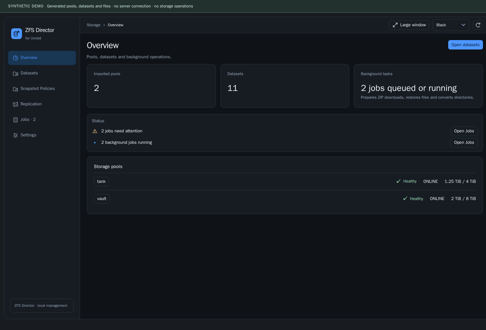


## Рабочая область

Дерево датасетов и детали выбранного объекта показаны рядом. У датасета четыре вкладки — **Overview, Properties, Snapshots и File Manager**; остальные действия собраны в одном меню **Actions**. При переходе между совместимыми объектами выбранная вкладка сохраняется: можно последовательно просматривать snapshots нескольких датасетов.

Overview начинается с карточки **Status**: здоровье pools и задачи, требующие внимания, со ссылкой на них. Пока операция держит блокировку, плашка **Running now** на любом экране называет её, а действия, которые будут её ждать, говорят об этом.

Доступны темы **Black, Gray, White, Azure** и **Unraid (auto)** с наследованием темы хоста. Интерфейс адаптируется к узкому экрану. Длинные формы и review прокручиваются внутри ограниченного окна.

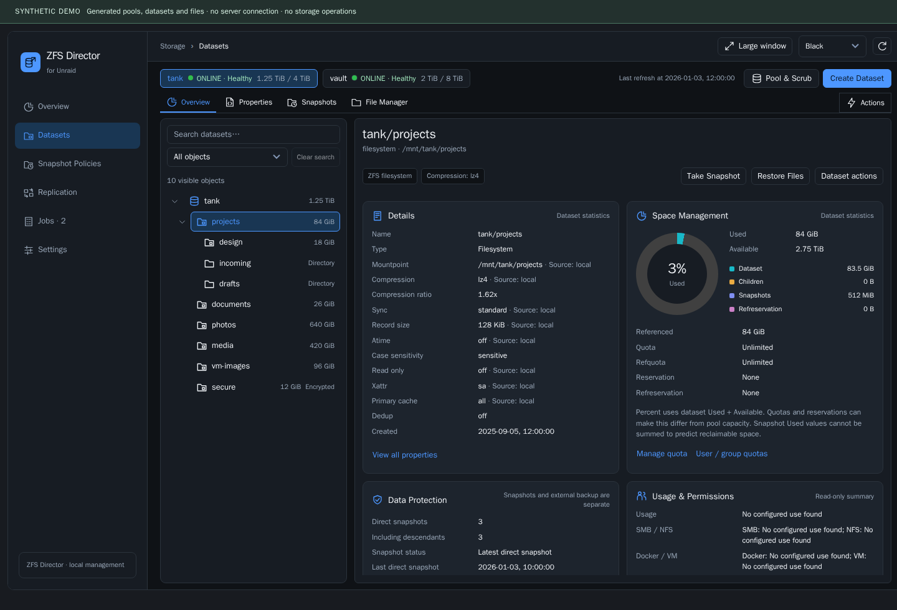

<details>
<summary>Другие темы и узкий экран</summary>

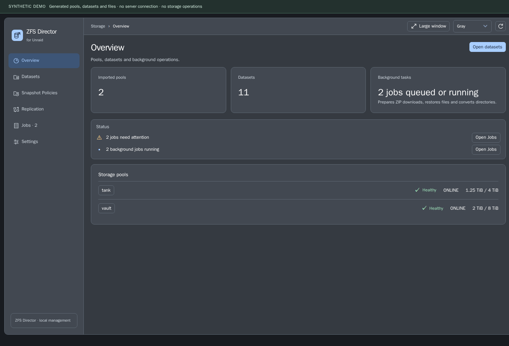

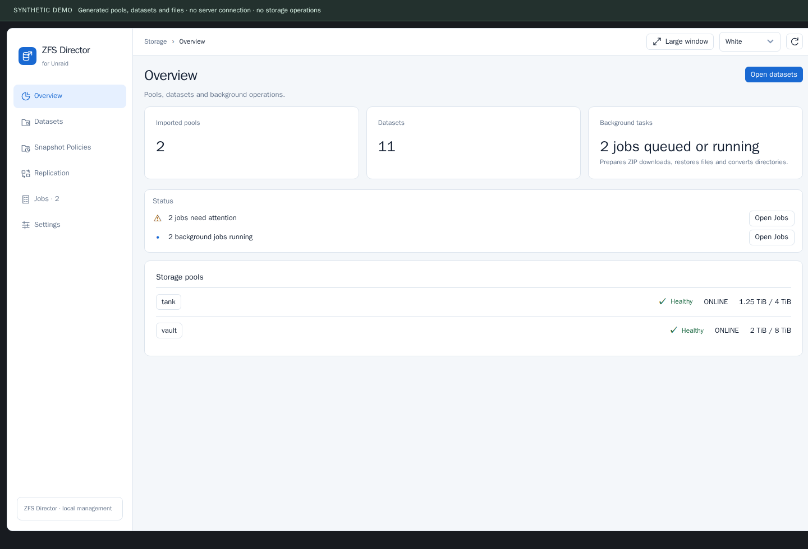

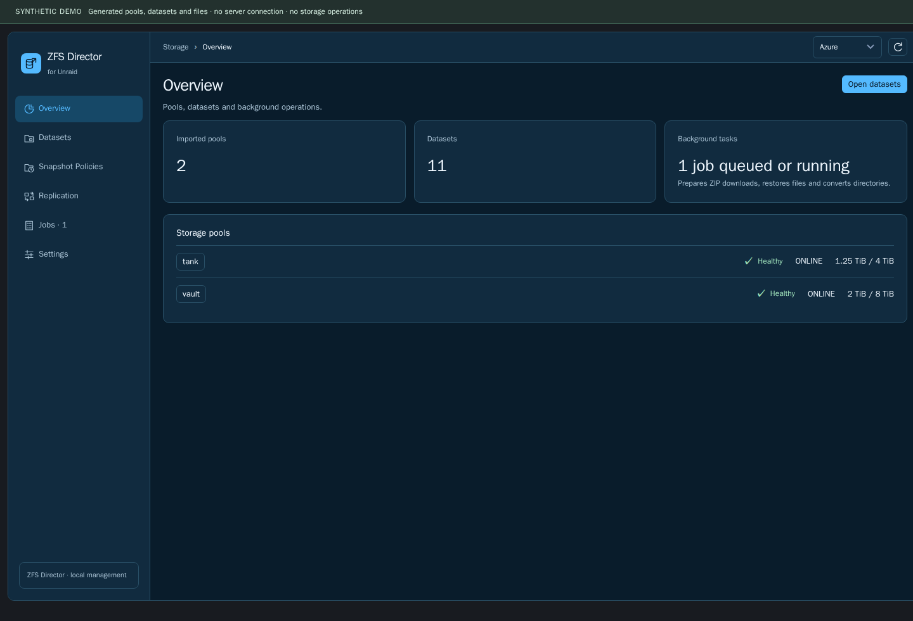

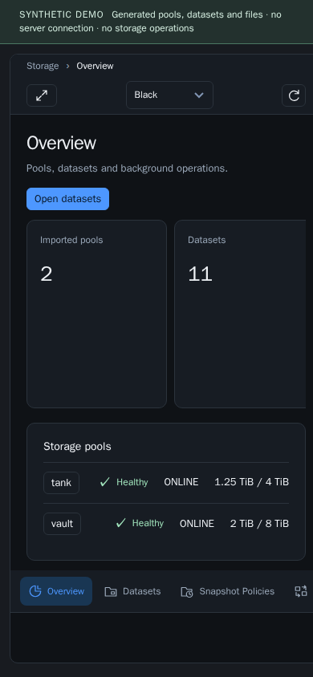

</details>


## Действия с datasets и каталогами

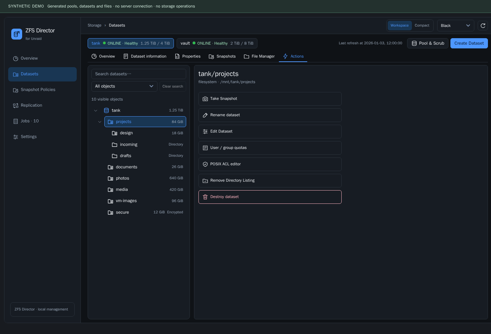

Actions открывает модальный редактор, затем отдельный review. Заголовок и нижние кнопки остаются доступны; длинное содержимое прокручивается внутри. **Back** возвращает редактор, **Close** закрывает окно и возвращает фокус. Закрытие не отменяет уже принятый backend запрос.

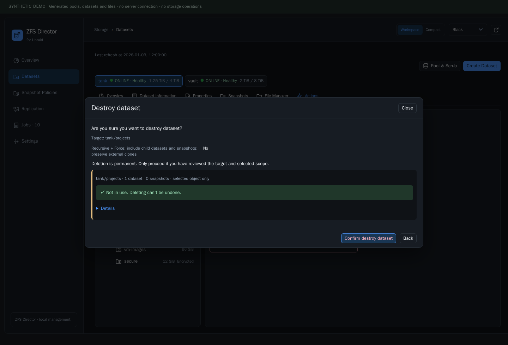

Для разрушительных действий нужны соответствующий режим, свежая inventory, identity цели и отдельное подтверждение. Удаление dataset/snapshots требует свежего серверного preview с точной областью, GUID и зависимостями. Удаление корня pool запрещено. Force не останавливает приложения, не снимает holds и не удаляет посторонние clones.

Подтверждённый read-only Docker mount родителя не блокирует удаление каждого обычного дочернего каталога. Writable и неизвестные режимы, ссылки на сам каталог или его содержимое и вложенные mounts остаются защищёнными. Worker повторно проверяет зависимости перед выполнением.

### Конвертация каталога с сохранением оригинала

Конвертация выполняется как фоновый Job. Сначала остановите всех writers, обеспечьте место для копий и после завершения проверьте содержимое. Копирование выполняется в ограниченном workflow; оригинал сохраняется для recovery.

Новые сохранённые оригиналы получают понятное имя: например, `incoming_archived_<дата-время>`. Старые recovery-имена остаются прежними. Внутренние `.zfsm-mutation-*` обычно скрыты из дерева и доступны через Jobs / recovery files. Незавершённые операции и сохранённые данные защищены; это не обычные папки для безусловного удаления. Очистка допустимых завершённых временных данных требует свежего review. Файлы, заменённые при восстановлении файлов, лежат в `.zfsm-restore-<id>/replaced`; рядом записано короткое описание (дата, snapshot, назначение), его показывает **Show recovery files** даже после удаления записи задачи, а **Delete retained files** удаляет папку после обычной проверки удаления. Пока восстановление не завершено (идёт, упало или требует проверки), удаление отказывает: сначала откройте эту задачу в Jobs. Отдельные файлы внутри папки удалять нельзя.


## Jobs: операции, progress и recovery

Jobs показывает только функциональную работу: конвертацию каталога, restore и подготовку ZIP, удаление dataset или каталога, запросы, отклонённые до старта, запуски репликации (плановые и ручные) и ручные запуски политик снимков (**Run now**). Быстрые действия, scrub, скачивания и плановые проверки снимков не показываются. Сбой плановой проверки политики показывается на самой политике в **Snapshot Policies** и в сводке Overview.

Политики снимков, репликация и файловые задачи выполняются в трёх отдельных фоновых очередях: долгая репликация не задерживает плановые снимки, restore и ZIP. Политика снимков по-прежнему ждёт, пока локальная репликация принимает данные в её dataset.

- Карточка называет процесс, источник и назначение, способ запуска и итог простыми словами (например, **Running: copying files** или **Failed:** и причина).
- Неудавшееся быстрое действие (например, отказ создать snapshot) не сохраняется как задача: ошибка видна в окне действия и записана в журнал аудита.
- После успешного действия окно показывает только результат и кнопку Close.
- Числовой progress показывается при наличии измерения. Иначе виден этап, без придуманного процента.
- Ошибки связываются с операцией и доступным безопасным контекстом.
- История различает копирование, verification, публикацию и recovery.
- Удаление допустимых snapshots с сохранением защищённых имеет результат **Completed with warnings** и понятный итог.
- Доступны фильтры и страницы: по умолчанию **10 записей**, можно выбрать больше.
- **Delete finished jobs** сразу удаляет на всех страницах записи завершённых задач, подходящих под текущие фильтры; галочка **Everything** снимает фильтры. Строка над списком сообщает, что удалено и что оставлено. Остаются те же задачи, что и при автоматической очистке. Удаление записи ZIP удаляет и сам файл ZIP (если файл удалить не удалось, запись остаётся); запись, которая держит snapshot, остаётся и объясняет это.
- Resume/cleanup появляются только при поддержке backend; завершённая или небезопасная работа не возобновляется автоматически.

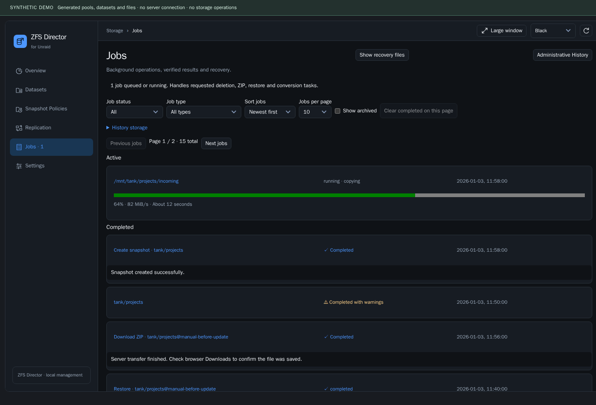

### Ограничение объёма истории

Завершённые задачи удаляются автоматически через **7 дней** по умолчанию. Срок меняется в **Settings → Keep finished jobs for**: 1 день, 7 дней, 30 дней или Always. Проверка идёт раз в час. Остаются только выполняющиеся задачи, задачи со snapshot или ZIP, который ещё лежит на диске, и конвертации и восстановления файлов, которые могут владеть сохранёнными данными; кнопка **Delete finished jobs** работает по тем же правилам. Последний результат каждой политики и репликации остаётся на экранах Snapshot Policies и Replication. Datasets, snapshots и файлы не затрагиваются.


## Окружение и состояние

Целевое окружение — **Unraid 7.3.3 с OpenZFS 2.4.4**. Необходимые native helpers проверяются во время работы. Для Data Protection нужна совместимая доверенная установка Sanoid / Syncoid.

Director сам создаёт и обслуживает постоянное и временное хранилище. Обновления сохраняют существующие настройки и journals. Code-only rollback не должен заменять актуальное состояние старым backup.

Ошибка доверия к правам/цепочке путей требует inspection, а не массового chmod. Внешние расписания и scripts не принимаются и не исправляются автоматически.

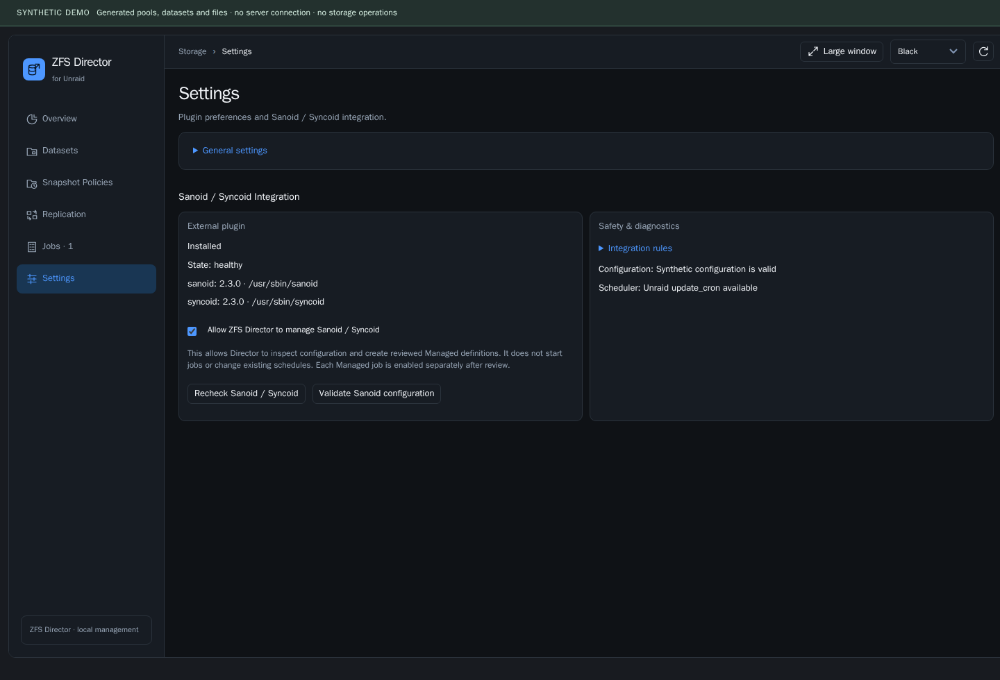


## Структура репозитория

```text
src/                 Плагин, интерфейс и native helpers
tests/               Регрессионные, GUI- и интеграционные тесты
tools/               Сборщик пакета и проверки релиза
docs/                Установка, разработка и тестирование
docs/images/         Скриншоты с вымышленными данными
docs/preview/        Демонстрация и инструменты съёмки скриншотов
```

## Лицензия и происхождение

[GPL-2.0-or-later](LICENSE).

Основан на [ZFS Master](https://github.com/IkerSaint/ZFS-Master-Unraid) — автор [Carlos Rodriguez (IkerSaint)](https://github.com/IkerSaint), copyright 2021. Происхождение кода и сохранённые уведомления приведены в [NOTICE.md](NOTICE.md).


## Для разработчиков

Сборка из исходников, тесты и синтетическая демонстрация описаны в [developer guide](docs/DEVELOPMENT.md). Для установки эти шаги не нужны.
